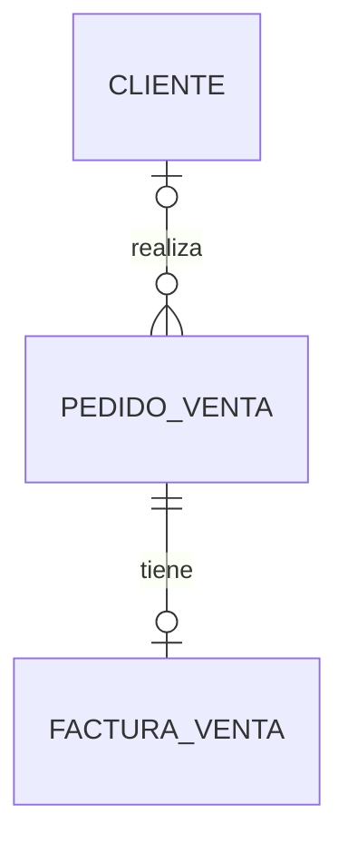

# Verificación de cliente, pedido y factura

Ejecutar desde `backend`:

```sh
php artisan test --filter=ClientePedidoFacturaTest
```

Las pruebas utilizan una conexión SQLite exclusiva en memoria y las migraciones
del flujo. No modifican la base configurada en `.env`.



- `pedido_venta.cliente_id` apunta a `cliente.id`. Admite nulos para conservar
  pedidos anteriores; esto no define la validación del futuro checkout.
- `factura_venta.pedido_venta_id` apunta a `pedido_venta.id`. La nueva migración
  del 20 de septiembre agrega unicidad para hacer cumplir la relación uno a uno.
- Se prueban varios pedidos de un cliente, separación entre clientes, pedidos
  sin factura, navegación inversa y pedidos históricos sin cliente.
- Se prueba el rechazo de una segunda factura y la detección de duplicados
  existentes sin eliminar registros.

## Límites y siguiente comprobación

SQLite no agrega la clave foránea de cliente al alterar la tabla con esta
combinación de Laravel y SQLite. Dos pruebas iniciales de integridad referencial
no rechazaron registros inválidos por esa limitación y se retiraron de esta
suite: no constituyen una validación de MySQL.

En una base MySQL de desarrollo separada queda pendiente verificar:

1. Reconstrucción completa de todas las migraciones.
2. Rechazo de pedidos con un `cliente_id` inexistente.
3. Rechazo del borrado de clientes con pedidos.
4. Aplicación y reversión de la nueva restricción única.

La migración nueva no fue aplicada a la base local durante esta revisión.
Antes de aplicarla, revisar si existen pedidos con más de una factura; la propia
migración hace esa comprobación y aborta si los encuentra.
